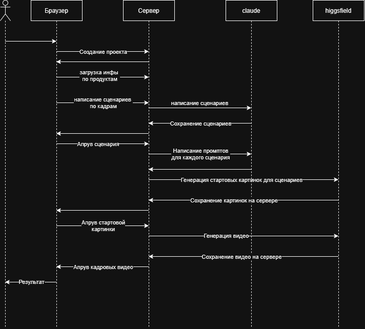

# Что за сервис

Приложение которое будет создавать полноценное видео со сценарием по картинке продукта. Кому это нужно? Например для селлеров в РФ или если ориентируемся на весь мир для дропшиперов или рекламных агенств.

# Требования
Сколько пользователей - ориентируемся на worldwide по этому тысячи

Длительность видео: 15-60 сек

Качество: Высокое не просто чтото там в кадре покрутилось и все, а будем работать с болями ца.

Цена: Создание 1 видео 30 сек с 6 кадрами(5 сек на кадр) обходиться примерно в 1к руб(без учета создания промптов, стартовых картинок и перегенераций)

Производительность: Будет ориентироваться на время генерации всего видео в пределах 5 минут. Поэтому важно чтобы задачи по генерации могли выполняться параллельно т.к. генерация 1 видео длиной 6 сек может занимать до 4 мин(может и больше), картинки от нескольких секунд

Что дорого: создание видео дороже всего

# Сущности и их статусы
Человек создает Проект сущность Project

У проекта есть картинки продукта ProductImages[]

перед генерацией видео нужен сценарий Scenario[]

Для генерации видео нужна сцена: пропты, что просисходит в сцене, стартовая картинка сцены Scene[], ScenePrompt, SceneImage
Для всего этого у проекта есть набор того что етсь Assets[]

Генерация

|сущность | статусы |
|-|-|
|картинки | image_draft, image_approved|
|видео |video_apprved, video_draft|
|сценарии | scenario_draft, scenario_approved|
|Сцены |scene_draft, scene_approved|

картинки image_draft/ image_approved 
видео video_apprved/video_draft
сценарии scenario_draft/scenario_approved
Сцены scene_draft/scene_approved
Промпты для генерации картинки для сцены 
Промпты для генерации видео по картинке
итого храним проект все его картинки/видео/сценарии

# FLOW
